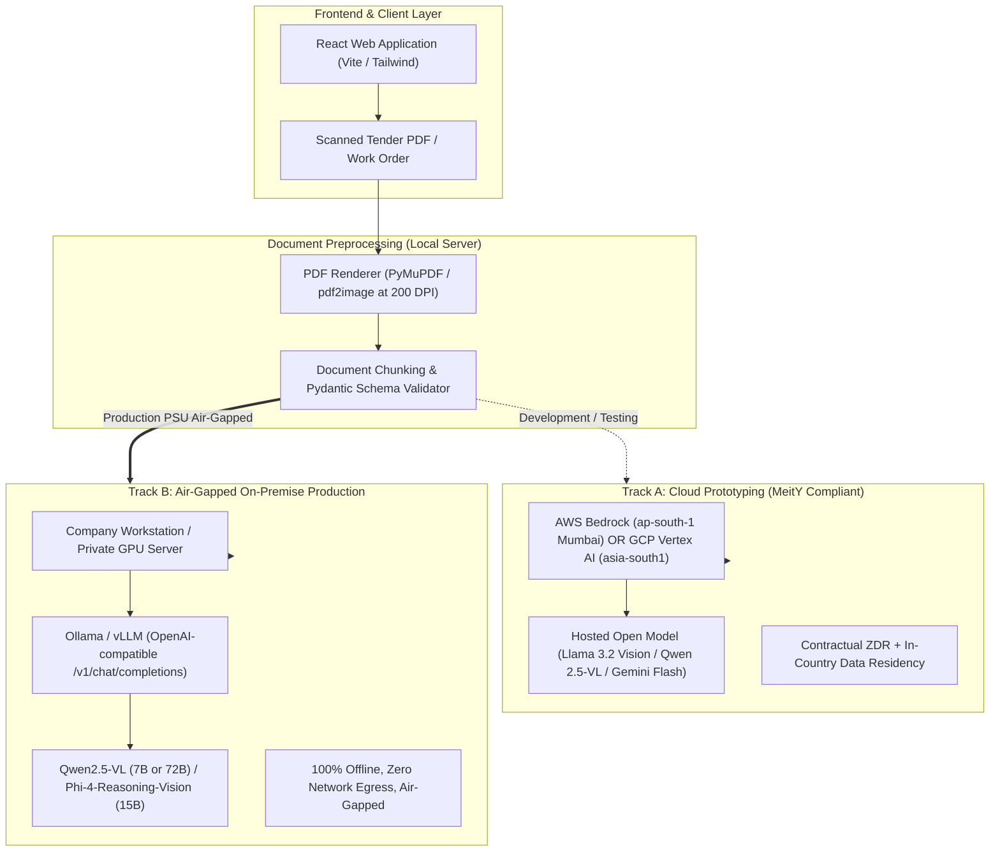

# Comprehensive Research Report: Offline/Open-Weight Document Extraction Models, Privacy-Hardened Cloud APIs, and Indian PSU Data Residency Compliance (2026)

---

## Executive Summary & Strategic Context

This research evaluates the transition path for the **AI Tender Qualification Assistant**—an intelligent technical bid evaluation system for Indian Public Sector Undertakings (PSUs)—from third-party proprietary APIs (such as Gemini) to a sovereign, privacy-guaranteed architecture. 

The ideal enterprise trajectory consists of two stages:
1. **Stage 1 (Rapid Prototyping / Hybrid Deployment):** Accessing models via privacy-hardened Cloud APIs with contractual Zero Data Retention (ZDR) and strict non-training guarantees, ideally hosted within Indian borders.
2. **Stage 2 (Full Air-Gapped / Self-Hosted Production):** Deploying the identical open-weight models on company on-premise servers or MeitY-empanelled sovereign infrastructure using **Ollama**, **vLLM**, or **SGLang** with zero external cloud dependencies.

---

## Part 1: Best Offline / Open-Weight LLM & VLM Models for Document Extraction (7B–70B Range)

Document extraction from scanned tender documents, NITs (Notices Inviting Tender), work orders, and financial statements involves unique hurdles: complex table structures, multi-column layouts, low-resolution scans, rubber stamps, signatures, and handwritten notes. Standard text-only LLMs fail because scanned PDFs lack a reliable text layer. 

The following models lead the open-weight category for **multimodal vision, dense OCR, structured JSON output, and local runtime support**.

### 1. Model Rankings & Comparison

| Model | Size & Architecture | Key Document & OCR Strengths | Structured JSON Adherence | Local Runtime Support | Cloud API Availability |
| :--- | :--- | :--- | :--- | :--- | :--- |
| **Qwen2.5-VL** *(Top Recommendation)* | **7B & 72B** Dense | **Dynamic Resolution ViT:** Reads native DPI without downsampling distortion. Benchmark leader on OCRBench, DocVQA, InfoVQA, and Table Parsing. | Exceptional. Natively trained on JSON and QwenVL HTML layout parsing. Strict JSON with schema enforcement. | **Ollama** (`qwen2.5-vl:7b`, `72b`), **vLLM**, SGLang, llama.cpp | Alibaba Cloud DashScope, Together AI, Fireworks AI, DeepInfra |
| **Phi-4-Reasoning-Vision** *(Microsoft)* | **15B** Dense (Reasoning VLM) | **Dynamic resolution (up to 3,600 visual tokens).** Dual-mode execution (`think` mode for deep multi-step reasoning over contracts vs `nothink` mode for fast text/table extraction). | Outstanding. Highly calibrated for schema following and DocVQA benchmarks. | Hugging Face Transformers, vLLM, Ollama (GGUF community) | Azure AI Foundry, GitHub Models |
| **Pixtral 12B** *(Mistral AI)* | **12B** Dense | **Native resolution & aspect ratio encoding.** 128k context window allows processing multi-page document packages simultaneously. Excels at ChartQA. | Excellent when paired with structured function calling / tool use (`tool_choice: "required"`). | **vLLM** (native), **Ollama** (`pixtral:12b`), Mistral-inference | Mistral La Plateforme, Azure AI Foundry, AWS Bedrock, Scaleway |
| **Llama 3.2-Vision** *(Meta)* | **11B & 90B** Dense | Built specifically for visual reasoning, OCR, and chart understanding. 11B is optimized for local workstation hardware. | High. Enforces schema via Ollama `format: schema` or outlines. | **Ollama** (`llama3.2-vision:11b`), **vLLM**, llama.cpp | Groq Cloud, Together AI, Fireworks AI, AWS Bedrock, Azure AI Foundry |
| **Gemma 3** *(Google)* | **12B & 27B** Dense (Multimodal) | Native multimodal (MobileNet-V5 vision encoder, 128k context). **Multilingual support across 140+ languages** (strongest for Hindi, Marathi, Bengali, Tamil in Indian tenders). | Very strong structured output capabilities via constrained decoding. | **Ollama** (`gemma3:12b`), Hugging Face, vLLM | Google Cloud Vertex AI (Model Garden), Together AI |
| **DeepSeek-VL2 & DeepSeek-OCR-2** | MoE (1B–4.5B active) / Causal Flow | **Contextual Optical Compression:** Achieves up to 20x token compression of scanned document pages with high reading-order accuracy across complex columns. | Strong for Markdown tables and JSON key-value extraction. | vLLM, Hugging Face, local Triton server | DeepSeek API, SiliconFlow |

---

### 2. PDF Processing & Structured Output Engineering

To achieve production-grade accuracy from scanned PDFs using open-weight models:

#### A. PDF Ingestion Pipeline
1. **Scanned PDF Handling:** PDFs must be converted into high-DPI images (150 to 300 DPI) using libraries like `pdf2image` (poppler) or `PyMuPDF` (`fitz`). 
2. **Dynamic Tiling:** Models like **Qwen2.5-VL** and **Phi-4-Reasoning-Vision** dynamically tile images to preserve high-frequency details (small numerical tables, subscripts, stamped clauses).

#### B. Guaranteed JSON Schema Enforcement
Never rely on prompt instructions alone to get JSON. Use constrained grammar decoding:
- **In Ollama:** Pass the Pydantic schema using the `format` parameter (`ollama.chat(..., format=TenderExtractionSchema.model_json_schema())`).
- **In vLLM / SGLang:** Use `guided_decoding` with `outlines` or `xgrammar` (`response_format={"type": "json_object", "schema": ...}`) which masks invalid tokens at each decoding step, mathematically guaranteeing 100% valid JSON.

#### C. Local Hardware Sizing Guide
*   **7B – 12B Models (Qwen2.5-VL 7B, Pixtral 12B, Llama 3.2-Vision 11B):**
    *   *Quantization:* 4-bit (Q4_K_M) or 8-bit (AWQ / GPTQ).
    *   *Hardware:* Runs on **1x 16GB–24GB GPU** (NVIDIA RTX 4080/4090, RTX 3090, L4, or A5000), or CPU with ~16–32 GB RAM (at lower token/sec).
*   **15B Models (Phi-4-Reasoning-Vision 15B):**
    *   *Hardware:* Runs smoothly on **1x 24GB GPU** (RTX 3090/4090 / A5000) under Q4/Q8 quantization.
*   **70B – 72B Models (Qwen2.5-VL 72B, Llama 3.2-Vision 90B):**
    *   *Quantization:* 4-bit (AWQ / EXL2 / GGUF).
    *   *Hardware:* Requires **2x to 4x 24GB GPUs** (e.g., 2x RTX 4090 with NVLink/PCIe or 1x A100/H100 80GB) with ~45–50 GB VRAM allocated.

---

## Part 2: Cloud API Providers Data Privacy, Security & Indian PSU Compliance

Indian Public Sector Undertakings (PSUs) in energy, defense, petrochemicals, and infrastructure operate under strict legal and procurement frameworks:
- **MeitY STQC Empanelment:** Cloud Service Providers (CSPs) must be audited and empanelled by the Ministry of Electronics and Information Technology.
- **Data Sovereignty & In-Country Residency:** Data at rest, data in transit, metadata, and inference logs must stay strictly inside Indian geographical borders. Cross-border transmission of tender or commercial bids often violates CVC (Central Vigilance Commission) rules, the DPDP Act 2023, and public procurement norms.
- **US CLOUD Act Exposure:** US-based pure-play API endpoints are subject to extraterritorial warrants, making direct US API calls unacceptable for classified/strategic PSU data (Category A/B data).

### Comprehensive Provider Comparison Matrix

| Provider | Guarantee NO Training on Customer Data? | Data Retention Policy (Default vs ZDR) | Open-Weight Models Available (Self-Hostable)? | Security Compliance (SOC2 / ISO) | Indian PSU / Government Data Residency Support |
| :--- | :--- | :--- | :--- | :--- | :--- |
| **Google Cloud Vertex AI** | **YES** (Contractually guaranteed in Cloud ToS & DPA) | **Zero Data Retention** for ephemeral inference. VPC Service Controls & Customer-Managed Encryption Keys (CMEK). | **YES** (Hosts Gemini proprietary, PLUS Llama 3.x, Gemma 3, Qwen, Mistral in Model Garden) | SOC 1/2/3, ISO 27001, 27017, 27018, HIPAA, FedRAMP | **YES (Fully Compliant).** MeitY-empanelled CSP. Gemini and open models available in `asia-south1` (Mumbai) and `asia-south2` (Delhi). |
| **Microsoft Azure OpenAI & AI Foundry** | **YES** (Contractually guaranteed under Enterprise Agreement / MCA) | Default: 30 days for abuse monitoring. **Zero Data Retention (ZDR)** via approved Modified Abuse Monitoring (MAM) request. | **YES** (Azure AI Foundry offers Llama 3.x/4, Mistral, Phi-4, Qwen, DeepSeek via Model Catalog) | SOC 1/2/3, ISO 27001, 27018, HIPAA, FedRAMP High | **YES (Fully Compliant).** MeitY-empanelled CSP. Data centers in Central India (Pune), South India (Chennai). Must use Regional Endpoints (not Global). |
| **AWS Bedrock** | **YES** (Prompts and completions never used to train base models) | Default: No persistent storage of payload unless customer configures S3 logging. Configurable retention. | **YES** (Offers Llama 3.x/4, Mistral/Pixtral, Amazon Nova, DeepSeek, Qwen in Marketplace) | SOC 1/2/3, ISO 27001, 27017, 27018, HIPAA, FedRAMP High | **YES (Fully Compliant).** MeitY-empanelled CSP. `ap-south-1` (Mumbai) and `ap-south-2` (Hyderabad) support geographic cross-Region inference strictly within India. |
| **Anthropic API (Direct)** | **YES** (Commercial API terms prohibit model training) | Default: 30 days for abuse monitoring. **ZDR available** for enterprise agreements. | **NO** (Claude 3.5/3.7 Sonnet, Opus, Haiku are closed proprietary models). | SOC 2 Type II, ISO 27001:2022, HIPAA eligible | **NO.** Direct Anthropic API is hosted in the US. *(Note: Claude can be accessed via AWS Bedrock or GCP Vertex, but regional in-India processing depends on cloud cross-region inference settings).* |
| **Mistral AI (La Plateforme)** | **YES** (Scale / Paid API tiers do not train on user data) | Default: 30 days rolling log. **ZDR available** for eligible paid plans. | **YES** (Mistral 7B, NeMo 12B, Pixtral 12B, Mixtral 8x7B/8x22B have open downloadable weights). | SOC 2 Type II, ISO 27001:2022, ISO 27701:2019, GDPR | **NO (Direct).** La Plateforme infrastructure resides in the EU and US. *(However, open Mistral models can be self-hosted in India or run on Bedrock/Azure India).* |
| **Groq Cloud** | **YES** (Explicitly guarantees customer data is never used for training) | Default: Ephemeral inference (no prompt retention). Up to 30 days for debugging logs. **True ZDR toggle** available in console. | **YES** (Specializes entirely in hosting open-weight models: Llama 3.x/4, Qwen 2.5, DeepSeek, Gemma). | SOC 2 Type II, HIPAA eligible | **NO.** Groq LPU hardware is hosted solely in US / North American data centers. Not MeitY empanelled. |
| **Together AI** | **YES** (Opt-in only for training; default is strictly NO training) | **Configurable ZDR** in privacy settings. Prompts discarded immediately after generation. | **YES** (100+ open-source models: Llama, Qwen, DeepSeek, Gemma, Mistral). | SOC 2 Type II, ISO 27001:2022, HIPAA | **NO.** Hosted in US data centers. Cannot satisfy Indian data sovereignty. |
| **Fireworks AI** | **YES** (Explicit policy: customer data never trains shared models) | **Default Zero Data Retention (ZDR)** for inference requests. BYOB (Bring Your Own Bucket) option. | **YES** (Comprehensive open-weight catalog: Llama, Qwen, DeepSeek, Phi). | SOC 2 Type II, ISO 27001, ISO 27701, ISO 42001 (AI Management), HIPAA | **NO.** Server fleet located in US. Cannot satisfy Indian data localization. |
| **Indian Sovereign Clouds (Yotta Shakti, E2E Networks)** | **YES** (Dedicated sovereign infrastructure) | Full customer control (zero logging or local private disk storage). | **YES** (Provides bare-metal/managed GPU clusters to run vLLM/Ollama on open models). | ISO 27001, MeitY STQC certified | **YES (Highest Tier Sovereignty).** MeitY-empanelled CSPs and official IndiaAI Mission GPU partners. 100% data residency in Mumbai/Delhi-NCR. |

---

## Part 3: Specific Models Available BOTH as Cloud API and Downloadable Weights

For an enterprise building an exit strategy from cloud dependence, the following models provide 100% architectural parity: code written against the Cloud API (typically OpenAI-compatible `/v1/chat/completions`) works identically when pointed to an internal Ollama or vLLM server.

### 1. Qwen Series (Alibaba Cloud / Open-Source)
*   **Key Models:**
    *   **Qwen2.5-VL (7B, 72B):** Top multimodal model for OCR, technical drawings, and tabular JSON extraction.
    *   **Qwen2.5 (7B, 14B, 32B, 72B):** Standard dense LLMs; 32B and 72B rivals proprietary models on complex reasoning.
    *   **Qwen2.5-Coder (7B, 32B):** Industry-leading code and structured syntax generation.
    *   **Qwen 3 / Qwen 3.5:** Released in 2025/2026 featuring expanded MoE architectures (up to 235B+ parameters).
*   **Where Downloadable:** Hugging Face (`Qwen/Qwen2.5-VL-7B-Instruct`), ModelScope, Ollama library (`ollama pull qwen2.5-vl:7b`).
*   **Where Accessible via Cloud API:** Alibaba Cloud Model Studio (DashScope), Together AI, Fireworks AI, DeepInfra, OpenRouter.

### 2. Llama Series (Meta)
*   **Key Models:**
    *   **Llama 3.2-Vision (11B, 90B):** First multimodal Llama models, strong at document Q&A and image OCR.
    *   **Llama 3.1 & 3.3 (8B, 70B):** 128k context, enterprise workhorses for text analysis, compliance checks, and NIT parsing.
    *   **Llama 4 Series (Scout & Maverick):** Meta's 2025/2026 native multimodal Mixture-of-Experts (MoE) models with context windows up to 10M tokens (Scout) and 1M tokens (Maverick).
*   **Where Downloadable:** llama.com, Hugging Face (`meta-llama/Llama-3.2-11B-Vision-Instruct`), Ollama (`ollama pull llama3.2-vision:11b`).
*   **Where Accessible via Cloud API:** Groq Cloud (ultra-fast LPU inference), AWS Bedrock, Azure AI Foundry, Together AI, Fireworks AI, Google Cloud Vertex AI (Model Garden).

### 3. Mistral / Mixtral Series (Mistral AI)
*   **Key Models:**
    *   **Pixtral 12B:** 128k context multimodal model, native aspect-ratio processing.
    *   **Mistral NeMo (12B):** Developed with NVIDIA; strong multilingual reasoning.
    *   **Mixtral 8x7B & Mixtral 8x22B:** High-throughput MoE models for heavy text processing.
    *   **Ministral 3B & 8B / Mistral Small 24B:** Efficient edge and server deployments.
    *   *(Note: Mistral OCR and Mistral Large remain proprietary hosted endpoints).*
*   **Where Downloadable:** Hugging Face (`mistralai/Pixtral-12B-2409`), Ollama (`ollama pull pixtral:12b`), vLLM.
*   **Where Accessible via Cloud API:** Mistral AI La Plateforme, Azure AI Foundry, AWS Bedrock, Scaleway, Together AI.

### 4. DeepSeek Series (DeepSeek AI)
*   **Key Models:**
    *   **DeepSeek-VL2 (Tiny, Small, Standard):** Vision-Language MoE models with dynamic tiling for high-res documents.
    *   **DeepSeek-OCR / OCR-2:** Specialized visual causal flow models designed specifically for deep document and markdown table compression.
    *   **DeepSeek-V3 (671B MoE, 37B active):** Flagship reasoning/general model.
    *   **DeepSeek-R1 (671B & distilled 1.5B, 7B, 8B, 14B, 32B, 70B):** State-of-the-art chain-of-thought reasoning for contract disputes, technical deviation audits, and legal scrutinies.
*   **Where Downloadable:** Hugging Face (`deepseek-ai/DeepSeek-VL2`, `deepseek-ai/DeepSeek-R1-Distill-Qwen-14B`), Ollama (`ollama pull deepseek-r1:8b`).
*   **Where Accessible via Cloud API:** DeepSeek API, Together AI, Fireworks AI, Groq (distilled versions), SiliconFlow, Microsoft Azure AI Foundry.

### 5. Gemma & PaliGemma Series (Google)
*   **Key Models:**
    *   **Gemma 3 (1B, 4B, 12B, 27B):** Native multimodal (vision + text + audio), 128k context, MobileNet-V5 vision backbone, exceptional multilingual performance (>140 languages).
    *   **PaliGemma 2 (3B, 10B, 28B):** Specialized VLM fine-tuned for high-precision OCR, receipt parsing, and bounding-box spatial grounding.
    *   **Gemma 2 (9B, 27B):** High-density text models with sliding window attention.
*   **Where Downloadable:** Hugging Face (`google/gemma-3-12b-it`, `google/paligemma2-10b-pt-448`), Kaggle, Ollama (`ollama pull gemma3:12b`).
*   **Where Accessible via Cloud API:** Google Cloud Vertex AI (Model Garden), Together AI, Hugging Face Inference Endpoints.

### 6. Phi Series (Microsoft)
*   **Key Models:**
    *   **Phi-4-multimodal (5.6B):** Native speech, vision, and text processing in a compact footprint.
    *   **Phi-4-Reasoning-Vision (15B):** Dual-mode reasoning vision model (released March 2026), dynamic resolution up to 3,600 visual tokens, designed for dense document reading.
    *   **Phi-3.5-vision (4.2B):** Lightweight multi-frame document model.
*   **Where Downloadable:** Hugging Face (`microsoft/Phi-4-multimodal-instruct`, `microsoft/Phi-4-reasoning-vision-15B`), Azure ML.
*   **Where Accessible via Cloud API:** Azure AI Foundry, GitHub Models.

---

## Part 4: Strategic Recommendations for AI Tender Qualification Assistant

### Recommended Architecture: The "Twin-Track" Hybrid Roadmap



### Key Implementation Guidance:
1. **Primary Open-Weight Model Selection:**
   - **Default Workhorse for Standard Workstations (16GB–24GB RAM/VRAM):** **Qwen2.5-VL (7B)** or **Phi-4-Reasoning-Vision (15B)**. Both fit comfortably on a single RTX 3090/4090 or Apple Silicon / 32GB system RAM with 4-bit quantization and provide superior extraction of numerical financial limits, turnover criteria, and multi-line item schedules.
   - **High-Throughput Enterprise Server (80GB VRAM):** **Qwen2.5-VL (72B)** or **Llama 3.2-Vision (90B)** for near-perfect reading of degraded scans and complex bilingual (Hindi/English) NIT clauses.
2. **Cloud API Staging for Indian PSUs:**
   - If utilizing a cloud API during initial validation, **do NOT use direct US endpoints** (Groq, Together AI, Fireworks, or direct Anthropic), as this exposes tender data to cross-border transfer violations under MeitY and CVC guidelines.
   - **Compliant Cloud Path:** Deploy open-weight models (Qwen / Llama / Mistral) via **AWS Bedrock in `ap-south-1` (Mumbai)** or **Google Cloud Vertex AI in `asia-south1` (Mumbai)** with Regional Endpoints locked.
3. **Seamless Migration via OpenAI SDK:**
   Because both cloud providers (Together, Bedrock, Azure AI Foundry) and local runtimes (Ollama, vLLM) implement the standard OpenAI `/v1/chat/completions` API with JSON schema support, migrating from Cloud to 100% Offline requires changing only two environment variables in `.env`:
   ```env
   # Switch seamlessly from Cloud to Local:
   LLM_BASE_URL=http://localhost:11434/v1     # Ollama or vLLM local endpoint
   LLM_MODEL=qwen2.5-vl:7b                    # Identical open model name
   LLM_API_KEY=ollama-local                   # Dummy key for local inference
   ```
